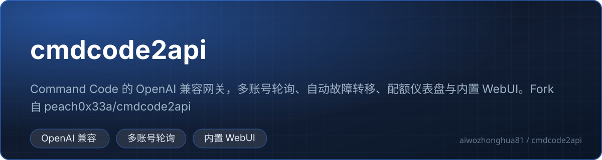

<!-- 中文说明开始 -->

# 🇨🇳 cmdcode2api 中文详细说明

<!-- 徽章区开始 -->
<p align="center">
  <a href="https://github.com/aiwozhonghua81/cmdcode2api"></a>
  
  
  
  
  
</p>
<p align="center">
  
  
  
</p>
<p align="center">
  
</p>
<!-- 徽章区结束 -->

> 这一节是为中文读者写的完整说明，放在最前面。
> 往下滚可以看到**上游项目的原始 README（英文原文）**，内容一个字都没有删改。
>
> 上游另外还提供了 [`README.zh-CN.md`](README.zh-CN.md)（精简版中文说明），本节是它的**加长扩充版**。

---

## 🧐 一、这是什么

**一句话：一个小型的「AI 接口转换站」，把 Command Code 的账号包装成标准的 OpenAI 接口，让任何一个只会说 OpenAI 格式的客户端都能直接用上 Command Code 的额度。**

拆开看：

```text
你的 AI 客户端（Cursor / Continue / 各种 SDK …）
        │  发标准的 OpenAI 请求：/v1/chat/completions
        ▼
   cmdcode2api（本地 HTTP 服务，默认 localhost:11434）
        │  ① 校验本地 API Key
        │  ② 在多个 Command Code 账号之间轮询，出错自动换号
        │  ③ 统计请求数和 token 数
        ▼
  Command Code 官方 API（api.commandcode.ai）
```

| 概念 | 大白话解释 |
| --- | --- |
| **Command Code** | 一个提供大模型 API 服务的商业服务（官网 commandcode.ai）。它有自己的账号、API Key、套餐额度制。 |
| **OpenAI 兼容** | 意思是「我假装自己是 OpenAI 的 API」。因为 OpenAI 的接口格式是事实标准，绝大多数 AI 客户端都支持它。做成 OpenAI 兼容 = 客户端几乎不用改配置就能用。 |
| **轮询（round-robin）** | 手里有 3 个账号，轮流用它们分摊请求，避免单个账号被打爆。 |
| **故障转移（failover）** | 某个账号返回 401/403/429/5xx 时，自动换一个账号重试，客户端无感。 |
| **冷却（cooldown）** | 账号返回 429（被限流）后，让它歇一会儿再上岗，避免继续撞墙。 |
| **客户端 Key** | 你自己发给各个客户端的 Key，用来区分「哪个工具用了多少」。**和上游的 Command Code Key 是两回事。** |
| **配额仪表盘** | 读上游的额度接口，画出 5 小时 / 本周 / 本月的额度进度条。 |

### 它和 `cmdc-pak-clean` 有什么区别？

两个项目都做「Command Code → OpenAI 格式」的活，但定位完全不同：

| 对比项 | `cmdcode2api`（本项目） | `cmdc-pak-clean` |
| --- | --- | --- |
| 运行位置 | 跨平台，可跑在服务器 / Docker 里 | 只跑在 Windows 本机 |
| 凭证来源 | 手动粘贴 Key 或走 OAuth 授权 | 直接读本机桌面版的 `auth.json` |
| 多账号 | ✅ 轮询 + 自动故障转移 + 429 冷却 | ❌ 单账号 |
| 管理界面 | 完整 WebUI（6 个标签页） | 单页轻量面板 |
| 配额可视化 | ✅ 5 小时 / 周 / 月进度条 | 部分（用量统计） |
| 客户端 Key 体系 | ✅ 多把 Key，各自独立统计 | ❌ 不校验 |
| 语言 | 英文为主，管理界面支持中英切换 | 中文 |
| 适合 | 团队 / 多账号 / 服务器部署 | 个人本机、图省事 |

---

## 👥 二、适合谁用 / 能解决什么问题

### 典型使用场景

| 场景 | 说明 |
| --- | --- |
| **手上有多个 Command Code 账号** | 全部加进 WebUI，网关自动轮询。某个账号欠费了、被限流了，自动切到下一个。 |
| **想在服务器上跑一个统一的 AI 接口** | Docker 一行命令起服务，团队里所有人连同一个地址，各自用不同的客户端 Key，用量分开统计。 |
| **想控制「哪个工具能用多少」** | 给 Cursor 一个 Key、给某个脚本另一个 Key，用量互不干扰，还能在面板上看到谁用了多少 token。 |
| **想随时知道额度还剩多少** | 仪表盘直接显示 5 小时窗口、本周窗口、月度估算的进度条，快用完时提前知道。 |
| **客户端只支持 OpenAI 格式** | 不用改客户端任何代码，把 Base URL 指过来就行。 |
| **想在多个客户端之间共享同一份 Command Code 额度** | 全部走这个网关，账号、配额、统计都集中在一处。 |

### 它**不**适合谁

- **想要 Anthropic 原生协议（`/v1/messages`）的人**：本项目只实现了 OpenAI 兼容接口。需要 Anthropic 协议请看 `cmdc-pak-clean`。
- **想要 Codex 的 Responses 协议的人**：同上。
- **需要严格计费/鉴权体系的生产系统**：这是个人工具，管理密码只有一个，没有角色权限。

---

## ⚙️ 三、核心功能

| # | 功能 | 大白话说明 |
| --- | --- | --- |
| 1 | **OpenAI 兼容接口** | `POST /v1/chat/completions`（流式 + 非流式）和 `GET /v1/models`。 |
| 2 | **多账号轮询 + 自动故障转移** | 请求在所有启用的账号间轮着来。遇到 `401` / `403` / `429` / 5xx 自动换下一个账号重试。 |
| 3 | **账号级 429 冷却** | 被限流的账号按上游返回的 `Retry-After`（默认 60 秒）休息，冷却期间直接跳过。所有账号都在冷却时，客户端收到 `429 rate_limit_error`，并告知最早恢复时间。 |
| 4 | **多客户端 Key** | 可以创建多把本地 Key，每个工具一把。**Key 值永远由服务端生成**（`ccgw-` 前缀），不接受外部输入，避免弱 Key。 |
| 5 | **分级用量统计** | 全局 / 按账号 / 按客户端 Key 三个维度分别统计请求数和 token 数，持久化到 `usage.json`，重启不丢。 |
| 6 | **配额仪表盘** | 读上游的额度接口，展示 5 小时 / 本周进度条、额度余额、套餐名、账期。**后台每 5 分钟自动刷新一次**，快照缓存在 `usage.json` 里。 |
| 7 | **内嵌单文件 WebUI** | 一个 `index.html` 打包进二进制，6 个标签页：Overview / Accounts / Models / Keys / Settings / Logs。改完立即生效，不用重启。 |
| 8 | **浏览器 OAuth 助手** | 一键走浏览器授权流程拿到 Command Code API Key。远程/容器场景下浏览器回不到本机，可以把回调链接手动粘贴回来。 |
| 9 | **模型开放编辑器** | WebUI 的 Models 页用复选框勾选哪些模型对外暴露，勾上的才能调，不勾的 `/v1/models` 里也看不到。 |
| 10 | **多模态图片输入** | 支持 base64 `image_url`、字符串形式 `image_url`、`input_image`、Anthropic 风格 `image` 块四种写法，统一转成 Command Code 的图片块。 |
| 11 | **管理密码防爆破** | 同一 IP 10 分钟内错 5 次，锁 15 分钟。 |
| 12 | **响应安全加固** | 返回带 CSP、`X-Frame-Options: DENY`、`nosniff`、`Referrer-Policy: no-referrer` 头，且一律不缓存。 |
| 13 | **中英双语管理界面** | 管理 API 的消息支持多语言（English / 简体中文）。**注意**：`/v1` 这类 OpenAI 兼容接口的消息**故意保持英文**，因为客户端 SDK 可能对错误文本做匹配。 |

---

## 🚀 四、怎么快速上手

### 4.1 前置条件

- **Go 1.25+**（`go.mod` 里写的是 `go 1.25`）
- 一个 **Command Code 账号**（拿 API Key 的方式见 4.4）

### 4.2 编译并运行

```bash
# 编译
go build -o cmdcode2api ./cmd/cmdcode2api

# 运行
./cmdcode2api
```

**第一次启动会发生什么？**

1. 在**当前工作目录**生成 `config.yaml`；
2. 生成一个客户端 API Key 和一个 WebUI 管理密码，**打印一次**（只打印这一次，之后只能从日志里找回或者去面板里重置）；
3. 启动 HTTP 服务，监听 `localhost:11434`。

> **「打印一次」是什么意思？**
> 这是安全上的常规做法：密码只在初始化时输出一次，避免它长期躺在日志文件里被人随手翻到。之后想看，可以打开 `config.yaml`（里面明文存着），或者在 WebUI 的 Settings 页里改。

### 4.3 用 Makefile（更省事）

```bash
make build          # 编译
make test           # 跑全部测试
make run            # 编译并运行
make clean          # 清理产物
make build-linux    # 交叉编译成 linux/amd64 静态二进制
```

`make all` = 先 `test` 再 `build`。

### 4.4 添加 Command Code 账号（三选一）

#### 方式 A：WebUI 里粘贴 Key（最简单）

浏览器打开 `http://localhost:11434/webui`，用管理密码登录 → **Accounts** 标签页 → 粘贴你的 Command Code API Key → 保存。

> **这个方式不受网络环境限制**，容器里、远程服务器上都行。

#### 方式 B：命令行 OAuth 授权

```bash
./cmdcode2api --oauth
```

程序会打印一个授权网址 → 浏览器打开 → 登录授权 → 回调到本机 `127.0.0.1:5959-5968` 之间的某个端口 → 授权成功后账号自动写进 `config.yaml`。

**每跑一次 `--oauth` 就添加一个账号。** 想加更多账号就多跑几次（可以用不同的浏览器 profile 区分身份）。重复授权同一个 Key 是幂等的，不会重复添加。

**浏览器在另一台机器上？** 用 SSH 转发回调端口：

```bash
# 本地机器
ssh -L 5959:127.0.0.1:5959 user@server

# 服务器上
./cmdcode2api --oauth --oauth-callback http://localhost:5959/callback
```

**在容器里？** 回调服务监听的是**容器内部**的 `127.0.0.1`，所以要用 host 网络：

```bash
# 浏览器在同一台机器
docker compose run --rm --network host cmdcode2api --oauth

# 浏览器在另一台机器（先做 SSH 转发）
ssh -L 5959:127.0.0.1:5959 user@server
docker compose run --rm --network host cmdcode2api --oauth \
  --oauth-callback http://localhost:5959/callback

# 不用 Compose
docker run --rm -it --network host -v cmdcode2api-data:/data \
  ghcr.io/peach0x33a/cmdcode2api:latest --oauth
```

授权完成后账号自动写进 `/data/config.yaml`，再 `docker compose up -d` 起服务。

> **远程场景下浏览器打不开回调怎么办？**
> Command Code 页面会把凭证放在跳转 URL 的查询串里（`?apiKey=…&state=…`），然后停在那儿。**你把地址栏里那一整条链接复制下来，粘贴到 WebUI 的「回调链接」输入框里提交即可。**
>
> 网关**只在本机解析这个链接，从不发起网络请求去访问它**。而且那个一次性 state token 必须和待处理的 OAuth 流程对得上，所以**伪造一个链接是注入不进账号的**。

#### 方式 C：直接编辑 config.yaml

```yaml
commandcode:
  base_url: https://api.commandcode.ai
  accounts:
    - name: main
      api_key: 你的-command-code-api-key
      enabled: true
```

改完重启服务生效。

### 4.5 测试一下

```bash
curl http://localhost:11434/v1/chat/completions \
  -H "Authorization: Bearer <local-api-key>" \
  -H "Content-Type: application/json" \
  -d '{
    "model": "deepseek/deepseek-v4-flash",
    "messages": [
      {"role": "user", "content": "Hello"}
    ],
    "stream": false
  }'
```

> **注意**：没加任何账号之前，网关**照样能正常启动**，WebUI、客户端 Key、设置全都可用，但聊天请求会返回 `503 no_accounts`。
>
> **为什么要这样设计？** 因为容器部署时经常是「先把服务拉起来，再去 WebUI 里加账号」。如果没账号就直接拒绝启动，运维流程会别扭。

### 4.6 Docker 部署

**方式一：直接 docker run**

```bash
docker run -d --name cmdcode2api -p 11434:11434 \
  -v cmdcode2api-data:/data \
  ghcr.io/peach0x33a/cmdcode2api:latest
```

**方式二：Compose（推荐）**

```bash
cp docker-compose.example.yml docker-compose.yml
docker compose up -d
```

数据目录为空时首次启动会生成 `config.yaml` 并打印一次 Key 和管理密码，看日志：

```bash
docker compose logs
```

**本地构建镜像：**

```bash
docker build -t cmdcode2api .
```

**网络访问不了 proxy.golang.org 的话**（国内常见），加个构建参数换国内代理：

```bash
docker build --build-arg GOPROXY=https://goproxy.cn,direct -t cmdcode2api .
```

> **为什么要挂 `/data` 这个卷？**
> `config.yaml` 和 `usage.json` 都在 `/data` 里。不挂卷的话，容器一删重建，你的账号列表和用量统计就全没了。Dockerfile 里也专门写了 `VOLUME /data`。

### 4.7 服务器上一键部署（Linux + systemd）

仓库自带 `scripts/deploy.sh`，它会做：

```text
git pull → go vet → go test → go build → 备份旧二进制 → 原子替换 → 重启 systemd 服务
```

用法：

```bash
bash scripts/deploy.sh                                  # 用默认路径 /opt/cmdcode2api/cmdcode2api
bash scripts/deploy.sh /path/to/repo /opt/cmdcode2api/cmdcode2api cmdcode2api
bash scripts/deploy.sh --force                          # 强制停掉旧服务再替换
```

**它的设计很稳，值得说一下：**

- **先 `go vet` + `go test` 再 build** —— 代码有问题就不会部署上去。
- **原子替换** —— 先装到临时文件，再 `mv` 覆盖。不会出现「服务正在读一个被截断的二进制」的情况。
- **自动回滚** —— 替换前把旧二进制备份成 `.bak`；如果重启失败或者服务起不来，自动把旧版本恢复回去。
- **等健康检查** —— 重启后轮询 10 秒确认服务真的变成 active，而不是发个 restart 就走人。

### 4.8 跑测试

```bash
go vet ./...
go test ./...
go test -race -count=1 ./...     # CI 用的就是这个
```

CI（`.github/workflows/ci.yml`）在 `master` 分支的每次 push 和每个 `v*` tag 上运行，会做 vet、race 测试、宿主机构建、linux/amd64 静态构建。

---

## 🎛️ 五、命令行参数

| 参数 | 含义 |
| --- | --- |
| `--oauth` | 跑浏览器 OAuth 流程，获取一个 Command Code API Key |
| `--oauth-callback URL` | 显式指定 OAuth 回调地址，例如 `http://localhost:5959/callback` |
| `--host HOST` | 覆盖 HTTP 监听地址，例如 `0.0.0.0`（默认 `localhost`） |
| `--port PORT` | 覆盖 HTTP 监听端口（默认 `11434`） |
| `--debug` | 把请求体和所有上游 SSE 事件打到 stderr（排查问题用） |
| `--version` | 打印版本和 Go 运行时版本后退出 |

> **命令行参数 vs 配置文件，谁优先？**
> 命令行参数优先。Docker 镜像的 `CMD` 就是 `["--host", "0.0.0.0"]`，这样容器里的服务对外可达，而 `config.yaml` 里不用改。

---

## 🎛️ 六、配置说明

`config.yaml` 位于**工作目录**，首次启动自动生成，已被 git 忽略。

```yaml
api_key: ccgw-generated-local-client-key
api_keys:
  - name: default
    key: ccgw-generated-local-client-key
  - name: my-agent
    key: ccgw-another-client-key
admin_password: kR7vBn2xQm9T
webui: true
commandcode:
  base_url: https://api.commandcode.ai
  accounts:
    - name: main
      api_key: your-command-code-api-key
      enabled: true
    - name: backup
      api_key: another-command-code-api-key
host: localhost
port: 11434
exclude_models:
  - gpt-
  - claude-
  - gemini-
```

| 字段 | 说明 |
| --- | --- |
| `api_key` | **旧版**的单 Key 字段。加载时会自动迁移进 `api_keys` 列表，列表非空后在保存时清空。留着是为了兼容老配置。 |
| `api_keys` | 客户端使用的本地 bearer Key 列表。请求数和 token 用量按 Key 分别统计。在 WebUI 的 Keys 页管理，改动立即生效并持久化。 |
| `admin_password` | WebUI 管理 API 的密码。为空时首次启动自动生成并打印一次。 |
| `webui` | 设为 `false` 完全关闭 WebUI 和管理 API。 |
| `commandcode.accounts` | 上游 Command Code 凭证列表。请求在启用的账号间轮询。旧的单 Key 字段 `commandcode.api_key` 仍然接受，加载时迁移成单元素列表。 |
| `commandcode.base_url` | Command Code API 的基础地址。 |
| `host` | 监听地址，默认 `localhost`；改 `0.0.0.0` 就是监听所有网卡（**注意安全**）。 |
| `port` | 监听端口，默认 `11434`。 |
| `exclude_models` | 隐藏 / 拒绝的模型 ID 前缀列表。在 WebUI 的 Models 页用复选框维护。 |

> **`exclude_models` 默认排除 `gpt-`、`claude-`、`gemini-` 是为什么？**
> 因为这些前缀匹配到的是上游**别人的**模型名（比如 `openai/gpt-4`）。Command Code 是按自己的套餐给额度，默认把这些暴露出去会误导用户以为能用。判断方式是取最后一个 `/` 之后的部分，所以 `openai/gpt-4` 也会被排除。
>
> 想全部开放？把列表删掉，或者设 `exclude_models: []`。

---

## 🩺 七、常见问题 / 注意事项

### 7.1 账号与故障转移

| 现象 | 说明 |
| --- | --- |
| **所有账号都在冷却，返回 429** | 上游限流了。客户端会收到 `429 rate_limit_error` 并带上最早恢复时间，等一会儿再试。 |
| **400 / 422 会不会重试？** | **不会。** 请求本身有问题，换账号也没用，还会浪费额度。客户端主动取消的请求也不重试。 |
| **流式响应中途失败会重放吗？** | **不会。** 一旦开始往客户端发字节，就绝不切到另一个账号重放——那样客户端会收到两份内容拼在一起。故障转移只发生在「还没发出第一个字节」的窗口内。 |
| **切换账号会不会重复扣额度？** | 上游已经处理过的请求无法撤销，这是设计上的取舍：宁可少一点额度一致性，也不能给客户端发重复内容。 |

### 7.2 配额仪表盘

| 事项 | 说明 |
| --- | --- |
| **月度进度条是估算的** | 上游**没有**月度窗口接口。上限取自社区 CLI 的套餐映射（`individual-pro` → 30，`individual-pro-v1` → 80……），已用量 = 上限 − 剩余额度。面板上明确标注为「估算」。未知套餐只显示余额。 |
| **5 小时 / 本周是准的** | 直接来自上游返回的 `windowLimits` 对象。进度条分级：≥50% 变琥珀色，≥75% 深琥珀色，≥90% 变红。 |
| **接口是非官方的** | 来自 [commandcode-usage](https://github.com/MAXeaglet/commandcode-usage)，用的是上游未公开的 `/alpha/*` 接口（`whoami`、`billing/credits`、`billing/subscriptions`、`usage/summary`）。解析器做了容错：camelCase / snake_case、epoch 秒 / 毫秒 / ISO 时间戳、扁平或 `data` 包装的响应都能吃。 |
| **上游挂了会怎样** | 保留上一次成功的快照，只记录错误和检查时间，面板上会显示同步失败。 |
| **多久刷一次** | 启动后 shortly 刷一次，之后**每 5 分钟**一次。 |

### 7.3 模型相关

| 现象 | 说明 |
| --- | --- |
| **模型 ID 报 404** | 模型 ID 必须和 `/v1/models` 的输出**完全一致，包括厂商前缀**：<br>`deepseek/deepseek-v4-flash` ✅<br>`deepseek-v4-flash` ❌（缺前缀）<br>`deepseek-ai/deepseek-v4-flash` ❌（前缀错了） |
| **模型在列表里但调不动** | 在 WebUI 的 Models 页把它取消勾选。勾选 = 暴露且可调用，不勾 = 隐藏且拒绝调用。 |

### 7.4 图片输入

支持四种写法，都会转成 Command Code 的图片块：

```json
{"type": "image_url", "image_url": {"url": "data:image/...;base64,..."}}
{"type": "image_url", "image_url": "data:image/...;base64,..."}
{"type": "input_image", "image_url": "data:image/...;base64,..."}
{"type": "image", "source": {"type": "base64", "media_type": "...", "data": "..."}}
```

> **只接受内联 base64，不接受远程 URL。**
> 传 `https://example.com/a.png` 这种会被拒绝，返回 `400 invalid_request_error`。**网关永远不会去下载远程图片**——这既是安全考虑（防止 SSRF），也是避免中转带宽成本。

### 7.5 反向代理 / nginx

如果 nginx 和 cmdcode2api 在同一台机器上：

- 要转发 Cloudflare 的 `CF-Connecting-IP` 和 `X-Forwarded-For` 头。服务端**只接受来自回环地址的代理连接**带来的这些头，然后拿解析出来的地址做 HTTP 日志和管理员登录限流。直连请求即使伪造了代理头，也仍然用 TCP 对端地址。
- **`X-Forwarded-For` 只认最右边那一项。** 左边那些是客户端可控的——如果客户端每次请求都伪造一个新的最左项，就能不断轮换限流的 key，绕过锁定。所以**不要用 `proxy_add_x_forwarded_for`**（它会把客户端那一项追加到最右边，反而制造新的可控项）。正确做法是在 nginx 层只允许 Cloudflare 公布的代理 CIDR 连接源站，这样 `CF-Connecting-IP` 就没法被伪造。

### 7.6 安全相关

| 事项 | 说明 |
| --- | --- |
| **默认只监听 localhost** | 默认 `host: localhost`，外部机器访问不到。想对外提供必须显式改成 `0.0.0.0`——**改了就必须自己做好 HTTPS 和防火墙**。 |
| **管理密码只有一个** | 没有角色权限体系。一个人用没问题，团队用要自己在外层加访问控制。 |
| **登录爆破防护** | 同一 IP 10 分钟内失败 5 次 → 锁 15 分钟。 |
| **`config.yaml` 里有明文 Key** | 上游 Key 和客户端 Key 都是明文。**别把它提交到 git、别放进共享目录。**（仓库的 `.gitignore` 已经把它排除了。） |
| **改了管理密码会踢掉旧会话** | 这是有意的，防止旧会话继续操作。 |

### 7.7 使用范围

这是一个**个人自用**的工具，目标只是「当前开发期间观察到的 Command Code API 形状」。如果 Command Code 改了内部 API，适配层可能需要跟着更新。上游 README 原文里也写明了：项目原名 `cc-gateway`，后来改名 `cmdcode2api` 是为了避免和 Claude Code 常见的 `cc` 缩写混淆。

---

## 🔌 八、HTTP 接口一览

### 对外（OpenAI 兼容）

| 方法 | 路径 | 鉴权 | 说明 |
| --- | --- | --- | --- |
| `POST` | `/v1/chat/completions` | 需要客户端 Key | 聊天补全，流式 / 非流式都支持 |
| `GET` | `/v1/models` | 需要客户端 Key | 模型列表（已按 `exclude_models` 过滤） |
| `GET` | `/health` | 不需要 | 返回 `{"status":"ok"}` |
| `GET` | `/usage` | 不需要 | 用量统计（全局 / 按账号 / 按客户端 Key） |

### 管理（WebUI 用）

| 方法 | 路径 | 说明 |
| --- | --- | --- |
| `GET` | `/webui` | 管理界面 |
| `GET` | `/admin/api/overview` | 总览 |
| `GET` | `/admin/api/accounts` | 账号列表（含每个账号的配额对象） |
| `POST` | `/admin/api/accounts` | 添加账号 `{"name":"...","api_key":"..."}` |
| `PATCH` | `/admin/api/accounts/{id}` | 改账号（启停 / 改名 / 换 Key） |
| `DELETE` | `/admin/api/accounts/{id}` | 删账号 |
| `POST` | `/admin/api/accounts/{id}/test` | 连通性测试 |
| `POST` | `/admin/api/accounts/{id}/quota/refresh` | 刷新单个账号配额 |
| `POST` | `/admin/api/quotas/refresh` | 刷新全部（返回 202 + 后台刷新） |
| `GET` | `/admin/api/models` | 模型列表 |
| `PUT` | `/admin/api/models` | 设置暴露的模型 `{"exposed":["model-id",...]}` |
| `GET` | `/admin/api/keys` | 客户端 Key 列表 |
| `POST` | `/admin/api/keys` | 创建 Key `{"name":"..."}`（**值永远服务端生成**） |
| `GET` | `/admin/api/keys/{id}/reveal` | 显示完整 Key |
| `PATCH` | `/admin/api/keys/{id}` | 改 Key（启停 / 改名） |
| `DELETE` | `/admin/api/keys/{id}` | 删 Key |
| `GET` | `/admin/api/settings` | 读设置 |
| `PUT` | `/admin/api/settings` | 改设置 |
| `GET` | `/admin/api/logs?after=SEQ` | 日志（内存环形缓冲最后 500 行） |
| `POST` | `/admin/api/oauth/start` | 发起 OAuth |
| `POST` | `/admin/api/oauth/complete` | 提交回调链接 `{"callback_url":"..."}` |
| `GET` | `/admin/api/oauth/status` | OAuth 状态 |
| `POST` | `/admin/api/oauth/cancel` | 取消 OAuth |

管理接口统一用 `Authorization: Bearer <admin_password>` 鉴权，curl 也能调。

---

## 🗂️ 九、目录结构速览

```text
cmdcode2api/
├── cmd/cmdcode2api/main.go   # CLI 入口，只调 app.Run()
├── internal/
│   ├── app/                  # ★ 网关核心实现
│   │   ├── app.go            #   启动流程、命令行参数解析
│   │   ├── server.go         #   HTTP 服务器与路由注册
│   │   ├── handler.go        #   /v1/chat/completions、/v1/models 处理
│   │   ├── admin.go          #   /admin/api/* 管理接口
│   │   ├── accounts.go       #   上游账号管理、轮询、故障转移、429 冷却
│   │   ├── clientkeys.go     #   本地客户端 Key 的管理与统计
│   │   ├── cc.go             #   Command Code 上游 API 适配层
│   │   ├── oauth.go          #   OAuth 流程（CLI + WebUI 两种入口）
│   │   ├── quota.go          #   配额解析（容错的非官方接口解析器）
│   │   ├── usage.go          #   用量计数与 usage.json 持久化
│   │   ├── models.go         #   模型目录与 exclude_models 过滤
│   │   ├── config.go         #   config.yaml 的结构与读写
│   │   ├── types.go          #   公共类型定义
│   │   ├── events.go         #   上游 SSE 事件处理
│   │   ├── logging.go        #   日志
│   │   ├── logbuf.go         #   内存日志环形缓冲
│   │   ├── ratelimit.go      #   管理密码登录限流
│   │   ├── random.go         #   随机 Key / 密码生成
│   │   └── *_test.go         #   各模块的单元测试
│   ├── i18n/                 # 管理 API 的多语言（en / zh-CN）
│   └── web/
│       ├── index.html        # ★ 单文件 WebUI（go:embed 打包进二进制）
│       └── web.go            #   提供 /webui 路由
├── scripts/deploy.sh         # 服务器一键部署（pull → test → build → 原子替换 → 重启 → 失败回滚）
├── .github/workflows/ci.yml  # CI：vet + race 测试 + 多平台构建
├── Dockerfile                # 多阶段构建：golang:1.25-alpine → alpine:3
├── docker-compose.example.yml # Compose 示例（需复制成 docker-compose.yml）
├── Makefile                  # build / test / run / clean / build-linux
├── go.mod / go.sum           # 依赖（只有一个：gopkg.in/yaml.v3）
├── README.md                 # 英文原文（本文件下半部分）
├── README.zh-CN.md           # 精简版中文说明
└── codebase_review.md        # 一次代码审查的记录（中文）
```

**几个关键点：**

| 事项 | 说明 |
| --- | --- |
| **为什么只有一个依赖？** | 除了 YAML 解析，HTTP、加密这些全是 Go 标准库。编译出来的静态二进制扔到哪都能跑。 |
| **`internal/web/index.html` 为什么可以单独用浏览器打开？** | 它是纯前端单文件（所有 JS/CSS 内联），能直接指向任意一个运行中的网关实例。 |
| **日志为什么只在内存里？** | 环形缓冲只留最后 500 行，主要给 WebUI 的 Logs 页实时看。持久化的用量数据在 `usage.json` 里。 |

---

## 📊 十、本仓库说明

### 10.1 这是什么

本仓库是 **[`peach0x33a/cmdcode2api`](https://github.com/peach0x33a/cmdcode2api)** 的 fork（派生副本）。

| 层级 | 项目 | 地址 |
| --- | --- | --- |
| **本仓库** | `aiwozhonghua81/cmdcode2api` | https://github.com/aiwozhonghua81/cmdcode2api |
| **上游（唯一一层）** | `peach0x33a/cmdcode2api` | https://github.com/peach0x33a/cmdcode2api |

### 10.2 本仓库的改动

**代码层面：本仓库没有自己的 commit。**

核对结果：

| 核对项 | 结果 |
| --- | --- |
| 本地独有的 commit | **无**（本地所有 commit 都能在上游找到） |
| **落后上游的 commit** | **3 个** |

也就是说，本仓库当前 HEAD 是上游 `master` 的某个历史点，**比上游少了 3 个提交**：

| 落后的提交 | 内容 |
| --- | --- |
| `3f65bee` | `refactor(web): simplify console layout and modal interactions` —— WebUI 控制台布局和弹窗交互简化 |
| `54a0d7a` | `fix(quota): report GOAT plan limits as 20/50/100` —— GOAT 套餐的 5 小时 / 周 / 月额度上限修正 |
| `ab91c12` | `Merge pull request #12 from HardeNNN/fix/goat-plan-limits` —— 上面那个修复的合并提交 |

> **为什么本仓库没有动代码？**
> 这个仓库目前定位是「个人自用的镜像 + 中文说明」。上游更新很勤（三天前还在改配额逻辑），保持零本地改动可以随时无痛同步。
>
> **需要追平上游时**：
> ```bash
> git fetch upstream
> git merge upstream/master
> git push origin master
> ```
> 因为本地没有任何独有提交，这个 merge **不会有冲突**。

### 10.3 README 的结构

本 README 分成上下两半：

| 位置 | 内容 | 语言 |
| --- | --- | --- |
| **上半部分** | 「中文说明开始」～「中文说明结束」之间 | 中文（本节，你正在看的） |
| **下半部分** | 从 `# cmdcode2api` 那行开始往下 | 上游原始 README，英文，**一字未改** |

**本仓库还额外提供了第三个文件**：上游的 [`README.zh-CN.md`](README.zh-CN.md)（精简版中文说明，本仓库原样保留）。三份文档的关系：

| 文档 | 语言 | 篇幅 | 来源 |
| --- | --- | --- | --- |
| 本文件上半部分 | 中文 | 详细版 | **本仓库新增** |
| `README.zh-CN.md` | 中文 | 精简版 | 上游原样保留 |
| 本文件下半部分 | 英文 | 上游完整版 | 上游原样保留 |

### 10.4 被 git 忽略的文件

以下运行时产物和敏感文件**故意不提交**：

```text
cmdcode2api          # 编译出来的二进制
cc-gateway           # 项目改名前的旧名二进制
config.yaml          # 配置（含明文 Key）
usage.json           # 用量统计
*.exe                # Windows 可执行文件
.oauth_state         # OAuth 一次性 state
.oauth_url           # OAuth 授权 URL
log.txt* / *.log     # --debug 模式会把完整请求体写进日志，绝不能提交
```

---

## 🔗 十一、相关链接

| 资源 | 地址 |
| --- | --- |
| 上游仓库 | https://github.com/peach0x33a/cmdcode2api |
| Command Code 官网 | https://commandcode.ai |
| 配额接口参考（非官方） | https://github.com/MAXeaglet/commandcode-usage |
| Docker 镜像 | `ghcr.io/peach0x33a/cmdcode2api:latest` |

<!-- 中文说明结束 -->

---

（原上游 README 从这里开始）
# cmdcode2api

[中文说明](README.zh-CN.md)

`cmdcode2api` is a small OpenAI-compatible gateway for [Command Code](https://commandcode.ai/). OpenAI-style clients call the familiar `/v1/chat/completions` and `/v1/models` endpoints, and the gateway forwards requests to Command Code — rotating across multiple accounts, tracking usage, and serving a built-in admin WebUI.

## Features

- OpenAI-compatible `POST /v1/chat/completions` (streaming and non-streaming) and `GET /v1/models`
- Multiple Command Code accounts with round-robin rotation and automatic failover (`401`/`403`/`429`/5xx), including per-account 429 cooldown
- Multiple local client API keys with per-key request and token accounting
- Command Code quota dashboard: 5-hour / weekly / estimated monthly progress bars, credit balances, plan and billing period, refreshed in the background every 5 minutes
- Embedded single-file WebUI: usage dashboard, account/key management, model exposure editor, live settings, and log tail
- Browser OAuth helper for obtaining a Command Code API key (CLI or WebUI); each OAuth run adds an account
- Local bearer-token auth for clients, separate admin password for the WebUI
- Usage counters (global, per-account, per-client-key) and cached quota snapshots persisted to `usage.json`
- Multimodal image input: base64 `image_url`, string-form `image_url`, `input_image`, and Anthropic `image` blocks, converted to Command Code image blocks; CORS enabled for local UI clients
- `GET /health` and `GET /usage` endpoints

## Quick start

```bash
go build -o cmdcode2api ./cmd/cmdcode2api
./cmdcode2api
```

The first start writes `config.yaml` in the working directory and prints the generated client key and WebUI admin password once. Add a Command Code account (next section), then point any OpenAI client at the gateway:

```bash
curl http://localhost:11434/v1/chat/completions \
  -H "Authorization: Bearer <local-api-key>" \
  -H "Content-Type: application/json" \
  -d '{
    "model": "deepseek/deepseek-v4-flash",
    "messages": [
      {"role": "user", "content": "Hello"}
    ],
    "stream": false
  }'
```

The server starts fine with zero accounts — the WebUI, client keys, and settings all work, and chat requests return `503 no_accounts` until one is added. Adding the first account from the WebUI fetches the model catalog immediately.

## Docker

Prebuilt multi-arch images are published to GHCR by CI on every master push (`latest`) and every `v*` tag. `config.yaml` and `usage.json` live in the `/data` volume:

```bash
docker run -d --name cmdcode2api -p 11434:11434 -v cmdcode2api-data:/data ghcr.io/peach0x33a/cmdcode2api:latest
```

A ready-to-copy Compose file is provided as `docker-compose.example.yml`:

```bash
cp docker-compose.example.yml docker-compose.yml
docker compose up -d
```

With an empty data directory the first start generates `config.yaml`, prints the client key and admin password once (`docker compose logs`), and then serves. To build the image locally, use `docker build -t cmdcode2api .` — networks that cannot reach proxy.golang.org can pass `--build-arg GOPROXY=https://goproxy.cn,direct`.

## Adding Command Code accounts

### WebUI (simplest)

Open `/webui`, go to the **Accounts** tab, and paste a Command Code API key. This works regardless of container networking or SSH access.

The Accounts tab can also run the OAuth flow. It uses the server's local `127.0.0.1:5959-5968` callback ports, which works out of the box when the browser runs on the same machine. When it does not — remote or containerized deployments, or a browser that cannot reach that port — the Command Code page cannot hand the credential back automatically. In that case the page stops on a URL carrying the credential in its query string (`?apiKey=…&state=…`); paste that whole address-bar link into the **回调链接** field and submit it. The gateway parses the credential out of the link locally (it never fetches the URL), and the single-use state token still has to match the pending flow, so a forged link cannot inject an account.

### CLI OAuth

```bash
./cmdcode2api --oauth
```

The OAuth callback server always binds to `127.0.0.1:5959-5968` on the machine running the binary. Each successful flow appends one account to `config.yaml`; run `--oauth` again (e.g. with a different browser profile) to add more accounts, and re-authorizing an existing key is a no-op.

**Browser on the same machine** — open the printed authorization URL directly.

**Browser on a different machine** — forward a callback port over SSH and pass an explicit callback URL:

```bash
# local machine
ssh -L 5959:127.0.0.1:5959 user@server

# server
./cmdcode2api --oauth --oauth-callback http://localhost:5959/callback
```

### Inside a container

The callback server listens on `127.0.0.1:5959-5968` *inside the container*, so the browser must be able to reach that port in the container's network namespace:

```bash
# browser on the same machine: share the host network
docker compose run --rm --network host cmdcode2api --oauth

# browser on a different machine: forward the port over SSH first
ssh -L 5959:127.0.0.1:5959 user@server
docker compose run --rm --network host cmdcode2api --oauth \
  --oauth-callback http://localhost:5959/callback

# without Compose
docker run --rm -it --network host -v cmdcode2api-data:/data \
  ghcr.io/peach0x33a/cmdcode2api:latest --oauth
```

After authorizing, the account is appended to `/data/config.yaml` automatically; run `docker compose up -d` afterwards if the gateway is still stopped.

## Command-line flags

| Flag | Meaning |
| --- | --- |
| `--oauth` | Run the browser OAuth flow to obtain a Command Code API key |
| `--oauth-callback URL` | Explicit callback URL for `--oauth`, e.g. `http://localhost:5959/callback` |
| `--host HOST` | HTTP listen host override, e.g. `0.0.0.0` |
| `--port PORT` | HTTP listen port override |
| `--debug` | Print request bodies and all upstream SSE events to stderr |
| `--version` | Print the version and Go runtime version, then exit |

## Configuration

`config.yaml` lives in the working directory, is created automatically, and is ignored by git. Example shape:

```yaml
api_key: ccgw-generated-local-client-key
api_keys:
  - name: default
    key: ccgw-generated-local-client-key
  - name: my-agent
    key: ccgw-another-client-key
admin_password: kR7vBn2xQm9T
webui: true
commandcode:
  base_url: https://api.commandcode.ai
  accounts:
    - name: main
      api_key: your-command-code-api-key
      enabled: true
    - name: backup
      api_key: another-command-code-api-key
host: localhost
port: 11434
exclude_models:
  - gpt-
  - claude-
  - gemini-
```

Fields:

- `api_key` — legacy single local client key. Migrated into `api_keys` on load and cleared on save once the list is non-empty.
- `api_keys` — local bearer keys that clients use to call this gateway. Requests and token usage are tracked per key. Manage them in the WebUI; changes apply immediately and persist here.
- `admin_password` — password for the WebUI admin API. Generated on first start when empty and printed once.
- `webui` — set to `false` to disable serving the embedded WebUI and admin API entirely.
- `commandcode.accounts` — list of Command Code credentials. Requests rotate across enabled accounts (see below). The legacy single-key field `commandcode.api_key` is still accepted and migrated to a one-entry list on load.
- `commandcode.base_url` — Command Code API base URL.
- `host` — HTTP listen host. Defaults to `localhost`; use `0.0.0.0` to listen on all interfaces.
- `port` — HTTP listen port. Defaults to `11434`.
- `exclude_models` — model ID prefixes hidden from `/v1/models` and rejected by `/v1/chat/completions`. Maintained from the WebUI's Models tab, where the upstream catalog is shown with checkboxes.

New configs exclude `gpt-`, `claude-`, and `gemini-` by default. These prefixes match both plain model IDs such as `gpt-4` and provider-qualified IDs such as `openai/gpt-4` by checking the part after the final `/`. To make all models available, remove the entries or set `exclude_models: []`.

## Multi-account rotation

Every chat request is sent with the next enabled account in round-robin order. When an account fails with `401`, `403`, `429`, or a 5xx, the request is retried with the next account automatically:

- A `429` puts the account into cooldown for the upstream `Retry-After` duration (60 seconds by default); cooldown accounts are skipped until they recover. If every enabled account is cooling down, the client receives `429 rate_limit_error` with the earliest recovery time.
- `400`/`422` (bad request) and client-canceled contexts are not retried.
- Failover happens before any bytes are sent to the client; once a stream has started it is never replayed on another account.
- Per-account request/token counters persist in `usage.json`; error state, last error, and cooldown windows are runtime-only and visible in the WebUI.

## Client keys

`api_keys` holds the bearer keys clients use to call this gateway; different clients can each use their own key:

- Create keys in the WebUI's **Keys** tab — values are always server-generated (`ccgw-` prefix) and never accepted from input; keys can be enabled/disabled, copied, and deleted.
- Each key gets independent request and token counters, persisted in `usage.json` under `client_keys` and visible at `/usage`.
- Keys are masked in the list; reveal or copy them on demand — the full value is shown once at creation and available via the reveal endpoint.
- The legacy single `api_key` field keeps working and migrates to one key named `default` on load.

## WebUI

With `webui` enabled (the default), the binary serves an embedded single-file admin interface under `/webui` (the root path stays free for the API):

```text
http://localhost:11434/webui
```

Log in with the server address and `admin_password`. The same `internal/web/index.html` can also be opened directly in a browser and pointed at any running instance.

Tabs:

- **Overview** — version, uptime, listen address, usage counters, account/key/model summaries, and a quota sync summary (synced / exceeded / low-balance accounts, last refresh)
- **Accounts** — add (paste a key, or run OAuth and paste the redirect link when the browser cannot reach the server), edit name/key, enable/disable, connectivity test, quota refresh, delete; per-account requests, tokens, errors, cooldown state, last error, and quota. OAuth-added accounts are named after the Command Code user automatically
- **Models** — checkbox list of upstream models; checked = exposed via `/v1/models` and callable, unchecked = hidden. This is the editor for `exclude_models` and applies live
- **Keys** — create local client API keys, enable/disable, copy, delete; per-key usage (see [Client keys](#client-keys))
- **Settings** — edit `base_url` (live), `host`/`port`/`webui` (persisted, applied on restart), and change the admin password (requires the current password; every existing admin session is kicked afterwards)
- **Logs** — tail of the in-memory log ring (last 500 lines)

Changes to accounts and settings are written back to `config.yaml` immediately — no restart needed.

Security notes: admin authentication is rate limited per source IP (5 failed attempts in 10 minutes locks the source out for 15 minutes), responses carry hardening headers (CSP, `X-Frame-Options: DENY`, `nosniff`, `Referrer-Policy: no-referrer`) and are never cached, and the login form supports password managers (Bitwarden et al.). "Remember password" keeps the credential in `localStorage`; unchecked, it lives in `sessionStorage` and dies with the tab.

### Quota dashboard

The Accounts tab shows each account's Command Code quota, read with the same API key from the undocumented `/alpha/*` endpoints (`whoami`, `billing/credits`, `billing/subscriptions`, `usage/summary`):

- **5-hour** and **weekly** bars come straight from the upstream `windowLimits` objects. Bars grade amber at ≥50% used, heavier amber at ≥75%, and red at ≥90%.
- **Monthly** is *derived*: the API exposes no monthly window, so the cap comes from the community CLI's plan mapping (`individual-pro` → 30, `individual-pro-v1` → 80, …), with `used = cap − remaining credits`. It is labelled as estimated; unknown plans fall back to balance-only display.
- Credit balances (monthly remaining / purchased / free), plan name and status, billing-period end, and billing-period totals.
- A per-account **refresh quota** button and a **refresh all** button (which returns immediately and refreshes in the background).

Quota refresh runs once shortly after startup and every 5 minutes afterwards; the latest snapshot is cached in `usage.json` so it survives restarts. A failed query keeps the last successful snapshot and only records the error and check time. These endpoints come from [commandcode-usage](https://github.com/MAXeaglet/commandcode-usage); they are unofficial, so the parser tolerates field drift (camelCase or snake_case, epoch seconds / milliseconds / ISO timestamps, flat or `data`-wrapped responses).

### Admin API

The UI talks to a JSON API under `/admin/api/*`, authenticated with `Authorization: Bearer <admin_password>` (works for scripts and curl too):

```text
GET    /admin/api/overview
GET    /admin/api/accounts
POST   /admin/api/accounts             {"name": "...", "api_key": "..."}
PATCH  /admin/api/accounts/{id}        {"enabled": true}, {"name": "..."} or {"api_key": "..."}
DELETE /admin/api/accounts/{id}
POST   /admin/api/accounts/{id}/test
POST   /admin/api/accounts/{id}/quota/refresh
POST   /admin/api/quotas/refresh       202 + background refresh of every account; with {"id": "..."} it refreshes one account synchronously
GET    /admin/api/models
PUT    /admin/api/models               {"exposed": ["model-id", ...]}
GET    /admin/api/keys
POST   /admin/api/keys                 {"name": "..."} — the key value is always server-generated
GET    /admin/api/keys/{id}/reveal
PATCH  /admin/api/keys/{id}            {"enabled": true} or {"name": "..."}
DELETE /admin/api/keys/{id}
GET    /admin/api/settings
PUT    /admin/api/settings
GET    /admin/api/logs?after=SEQ
POST   /admin/api/oauth/start
POST   /admin/api/oauth/complete   {"callback_url": "<浏览器跳转后的完整链接>"}
GET    /admin/api/oauth/status
POST   /admin/api/oauth/cancel
```

`GET /admin/api/accounts` includes a nested `quota` object per account; `GET /admin/api/overview` includes a `quotas` summary (`synced`, `exceeded`, `low_balance`, `last_checked_at`).

## HTTP API

### `GET /health`

No authentication required.

```json
{"status":"ok"}
```

### `GET /usage`

No authentication required. Returns locally accumulated usage counters plus per-account and per-client-key breakdowns:

```json
{
  "total_requests": 1,
  "prompt_tokens": 7527,
  "completion_tokens": 55,
  "cache_read_tokens": 7424,
  "cache_write_tokens": 0,
  "accounts": {
    "a1b2c3d4": {"requests": 1, "prompt_tokens": 7527, "completion_tokens": 55, "cache_read_tokens": 7424, "cache_write_tokens": 0}
  },
  "client_keys": {
    "k9f8e7d6c": {"requests": 1, "prompt_tokens": 7527, "completion_tokens": 55, "cache_read_tokens": 7424, "cache_write_tokens": 0}
  }
}
```

Usage is persisted to `usage.json`, which is ignored by git. Cached quota snapshots also live in that file but are never exposed here.

### `GET /v1/models`

Returns the model list after applying `exclude_models` filtering, so excluded models do not appear. Each entry carries a `context_window` field when the upstream reports one.

### `POST /v1/chat/completions`

Accepts OpenAI-style chat completion requests and forwards them to Command Code. Requests for excluded models return `404` with an OpenAI-compatible error JSON shape.

**Model IDs** must match `/v1/models` output exactly, including the provider prefix:

```text
deepseek/deepseek-v4-flash          ✓
deepseek-v4-flash                   ✗ missing provider prefix
deepseek-ai/deepseek-v4-flash       ✗ wrong provider prefix
```

**Supported request styles:** plain text messages, multimodal content arrays, `stream: true` server-sent events, and `stream: false` JSON responses.

**Images:** the gateway accepts several image shapes and converts them to Command Code image blocks:

- `{"type":"image_url","image_url":{"url":"data:image/...;base64,..."}}` — standard OpenAI
- `{"type":"image_url","image_url":"data:image/...;base64,..."}` — string form
- `{"type":"input_image","image_url":"data:image/...;base64,..."}`
- `{"type":"image","source":{"type":"base64","media_type":"...","data":"..."}}` — Anthropic style

Image data must be inline base64 (`data:image/...;base64,...`). Remote HTTP(S) image URLs and any other URL scheme are rejected with `400 invalid_request_error` — the gateway never downloads remote images.

Upstream `inputTokenDetails.cacheReadTokens` is exposed in the response as `usage.prompt_tokens_details.cached_tokens`. `cacheWriteTokens` is available in `/usage` but not in the Chat Completions response, because OpenAI's standard usage schema has no cache-write field.

## Running behind nginx

If nginx and cmdcode2api run on the same host, keep forwarding Cloudflare's `CF-Connecting-IP` and `X-Forwarded-For` headers. The server accepts these headers only from loopback proxy connections, then uses the resolved address for HTTP logs and admin login rate limiting. Direct connections with forged proxy headers continue to use their TCP peer address.

For `X-Forwarded-For`, only the rightmost entry (the one an appending proxy wrote) is honored: leftmost entries are client-controlled, and a client forging a fresh one per request would rotate its rate-limit key. Do not preserve the client-supplied header via `proxy_add_x_forwarded_for`, and prefer allowing only Cloudflare's published proxy CIDRs at the nginx level so `CF-Connecting-IP` cannot be forged by connecting to the origin directly. If nginx itself also needs `$remote_addr` to represent the end user, configure `real_ip_header CF-Connecting-IP` with Cloudflare's published proxy CIDRs.

Client Bearer Tokens are any key from the `api_keys` list in `config.yaml`.

## Project layout

```text
cmd/cmdcode2api/   CLI entrypoint
internal/app/      gateway implementation
internal/web/      embedded single-file WebUI (index.html)
```

## Files intentionally not committed

The repository ignores runtime/secrets artifacts:

```text
cmdcode2api
cc-gateway
config.yaml
usage.json
*.exe
.oauth_state
.oauth_url
```

## Notes

This is a personal utility gateway and currently targets the Command Code API shape observed during development. If Command Code changes its internal API, the adapter may need updates. The project was originally named `cc-gateway` and was renamed to avoid confusion with Claude Code's common `cc` abbreviation.
